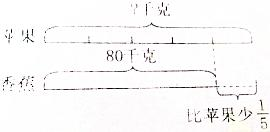

# Mathematics (Grade 6)

**ID**: 1fe7054b
**难度**: medium_hard
**题型**: fill_in_the_blank

## 题目
看图列算式．

## 解答

**答案**: 100

1. Step1:明确把苹果的质量看成单位'1'，香蕉质量是苹果的（1 - $\frac{1}{5}$）
2. Step2:已知香蕉对应的数量是80千克，根据对应数量除以对应分率求单位'1'的量，列出算式80÷（1 - $\frac{1}{5}$）
3. Step3:计算80÷（1 - $\frac{1}{5}$），先算括号里1 - $\frac{1}{5}$ = $\frac{4}{5}$，得到80÷$\frac{4}{5}$
4. Step4:计算80÷$\frac{4}{5}$ = 80×$\frac{5}{4}$ = 100（千克）

## 知识点

**知识点**:
  - 分数除法应用题

---
