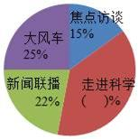

# Mathematics (Grade 6)

**ID**: 21122cd9
**难度**: medium_hard
**题型**: fill_in_the_blank

## 题目
下面是六年级学生喜欢的电视节目统计图．

（1）喜欢《走进科学》的同学人数占全班人数的 $\underline{\hspace{5em}}$ %．
（2）喜欢《焦点访谈》的人数比喜欢《大风车》的人数少 $\underline{\hspace{5em}}$ %，
（3）如果喜欢《走进科学》和《大风车》的同学人数共有126人，那么，六年级学生共多少人？（用方程解）

## 解答

**答案**: 38, 40

1. Step1:把六年级学生总人数看作单位‘1’，用1减去喜欢《大风车》、《新闻联播》、《焦点访谈》所占的百分比，即1 - 25% - 22% - 15% = 38%，得出喜欢《走进科学》的同学人数占全班人数的38%
2. Step2:先求出喜欢《焦点访谈》的人数比喜欢《大风车》的人数少的百分比，即(25% - 15%)÷25%×100% = 40%，得出喜欢《焦点访谈》的人数比喜欢《大风车》的人数少40%
3. Step3:设六年级学生共x人，根据喜欢《走进科学》和《大风车》的同学人数共有126人，可列方程(38% + 25%)x = 126，解方程得出六年级学生人数（本题只要求前两问答案，此步骤可省略）

## 知识点

**知识点**:
  - 小学数学;统计和概率;统计;统计图

---
