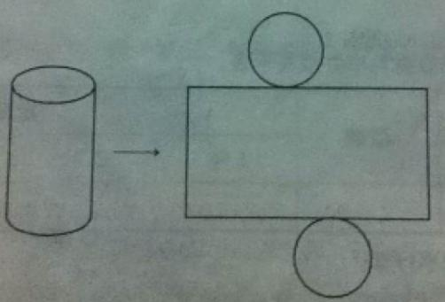

# Mathematics (Grade 6)

**ID**: 238b9eb3
**难度**: medium_hard
**题型**: fill_in_the_blank

## 题目
把一个圆柱展开后，得到一个长方形和两个圆．已知圆柱底面直径是1.2cm，高是2.03cm，  算一算得到的长方形的长和宽各是多少厘米．

## 解答

**答案**: 3.768, 2.03

1. Step1:根据圆的周长公式C = πd（其中C表示周长，d表示直径，π取3.14），已知圆柱底面直径d = 1.2cm，可得底面周长C = 3.14×1.2 = 3.768cm，此为长方形的一条边的长度
2. Step2:已知圆柱的高是2.03cm，此为长方形的另一条边的长度
3. Step3:比较3.768cm和2.03cm的大小，因为3.768cm>2.03cm，所以长方形较长的边即长为3.768cm，较短的边即宽为2.03cm

## 知识点

**知识点**:
  - 

---
