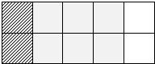

# Mathematics (Grade 6)

**ID**: 25c2951c
**难度**: medium_hard
**题型**: fill_in_the_blank

## 题目
图中的大长方形表示“1”，根据图中的斜线部分写乘法算式．
$\frac{4}{5}$×$\underline{\hspace{5em}}$=$\underline{\hspace{5em}}$．

## 解答

**答案**: \\frac{1}{4}, \\frac{1}{5}

1. Step1:将整个长方形看作单位'1'，可知涂色部分占长方形的$rac{4}{5}$
2. Step2:把涂色部分$rac{4}{5}$看作单位'1'，得出斜线部分占$rac{4}{5}$的$rac{1}{4}$
3. Step3:根据一个数乘分数的意义，用$rac{4}{5}$乘$rac{1}{4}$计算斜线部分占比
4. Step4:计算$rac{4}{5}×rac{1}{4}=rac{1}{5}$，所以第一个空应填$rac{1}{4}$，第二个空应填$rac{1}{5}$

## 知识点

**知识点**:
  - 分数乘法．

---
