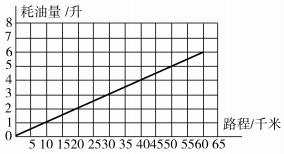

# Mathematics (Grade 6)

**ID**: 25df3cbd
**难度**: medium_hard
**题型**: fill_in_the_blank

## 题目
小强的爸爸开车出行。下图表示的是开车从黄冈到阳逻行驶的路程与耗油量之间的关系。

 1.行驶的路程和耗油量成（）比例。
 2.黄冈到阳逻有60千米，汽车耗油（）升。
 3.小强的爸爸在阳逻办完事后，想去离阳逻80千米的汉口。此时油箱里大约剩下7升汽油，他需要加油吗？

## 解答

**答案**: 正, 6, 需要加油

1. Step1:观察图象，发现行驶10千米耗油1升，行驶20千米耗油2升，行驶30千米耗油3升等，计算可得10:1=20:2=30:3=10（一定），根据正比例关系的定义，得出行驶的路程和耗油量成正比例
2. Step2:已知每升油可行驶10千米，黄冈到阳逻有60千米，用60除以10，即60÷10=6，得出汽车耗油6升
3. Step3:已知每升油可行驶10千米，离阳逻80千米的汉口，计算行驶80千米需要的油量为80÷10=8升，因为8升＞7升，所以得出他需要加油

## 知识点

**知识点**:
  - 

---
