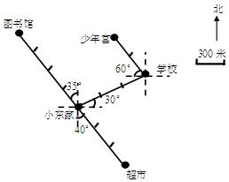

# Mathematics (Grade 6)

**ID**: 25e2956d
**难度**: medium_hard
**题型**: fill_in_the_blank

## 题目
填空．

小东从家向$\underline{\hspace{5em}}$      偏$\underline{\hspace{5em}}$      60°走大约$\underline{\hspace{5em}}$      米到学校，再向北偏西$\underline{\hspace{5em}}$      °走大约$\underline{\hspace{5em}}$      米到少年宫．

## 解答

**答案**: 北, 东, 900, 30, 600

1. Step1:根据地图方向辨别方法'上北下南，左西右东'及图中信息，确定从家到学校的方向为北偏东
2. Step2:由图中比例尺可知图上1段代表实际300米，从家到学校图上距离为3段，计算可得实际距离为300×3 = 900米
3. Step3:根据图中信息，确定从学校到少年宫的方向为北偏西，角度为30°
4. Step4:从学校到少年宫图上距离为2段，计算可得实际距离为300×2 = 600米

## 知识点

**知识点**:
  - 路线图

---
