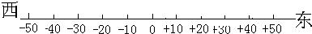

# Mathematics (Grade 6)

**ID**: 279721ec
**难度**: medium_hard
**题型**: fill_in_the_blank

## 题目
如图：如果汽车向东行驶50米记作+50米，那么汽车向西行驶20米记作$\underline{\hspace{5em}}$，一辆汽车先向西行驶40米，又向东行驶10米，这时汽车的位置记作$\underline{\hspace{5em}}$．

## 解答

**答案**: -20米, -30米

1. Step1:根据向东记为正，向西记为负的规则，汽车向西行驶20米，应记作-20米
2. Step2:汽车先向西行驶40米，位置记作-40米，又向东行驶10米，相当于在-40米的基础上加上10米，即-40 + 10 = -30米，所以这时汽车的位置记作-30米

## 知识点

**知识点**:
  - 负数的意义及其应用．

---
