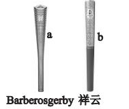

# Mathematics (Grade 6)

**ID**: 29f9bad6
**难度**: medium_hard
**题型**: fill_in_the_blank

## 题目
伦敦奥运会的火炬“Barberosgerby”，重量为800g，2008年北京奥运会“祥云火炬”重量是985克。“Barberosgerby”的重量是“祥云火炬”的几分之几？

## 解答

**答案**: 160/197

1. Step1:明确问题是求“Barberosgerby”的重量是“祥云火炬”的几分之几
2. Step2:根据分数除法的意义，确定用“Barberosgerby”的重量除以“祥云火炬”的重量来计算
3. Step3:已知“Barberosgerby”重量为800g，“祥云火炬”重量是985克，进行计算800÷985
4. Step4:将800÷985化简为分数形式，得到160/197

## 知识点

**知识点**:
  - 分数除法应用题

---
