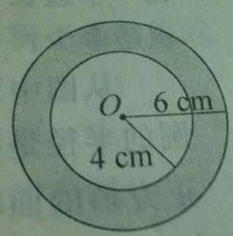

# Mathematics (Grade 6)

**ID**: 2b1664c0
**难度**: medium_hard
**题型**: fill_in_the_blank

## 题目
如图所示，我们把阴影部分叫做（  ），外圆的半径为（  ）厘米，面积为（  ）平方厘米；内圆的半径为(         )，面积为(      )平方厘米；圆环的面积等于（  ）的面积减去（  ）的面积，这个圆环的面积为（  ）平方厘米．

## 解答

**答案**: 圆环, 3, 28.26, 2, 12.56, 外圆, 内圆, 15.7

1. Step1:根据图形特征，可知阴影部分是圆环
2. Step2:由图可知外圆半径为6÷2=3厘米
3. Step3:根据圆的面积公式S = πr²，外圆面积为3²×3.14 = 28.26平方厘米
4. Step4:由图可知内圆半径为4÷2=2厘米
5. Step5:根据圆的面积公式S = πr²，内圆面积为2²×3.14 = 12.56平方厘米
6. Step6:因为圆环的面积等于外圆的面积减去内圆的面积
7. Step7:计算圆环面积为28.26 - 12.56 = 15.7平方厘米

## 知识点

**知识点**:
  - --

---
