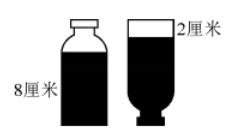

# Mathematics (Grade 6)

**ID**: 2d5ec674
**难度**: medium_hard
**题型**: fill_in_the_blank

## 题目
如图，一个胶水瓶，它的瓶身呈圆柱形（不包括瓶颈），容积为32.4立方厘米。当瓶子正放时，瓶内胶水液面高为8厘米；瓶子倒放时，空余部分高为2厘米。请你算一算，瓶内胶水的体积是 $\underline{\hspace{5em}}$ 立方厘米。

## 解答

**答案**: 25.92

1. Step1:根据胶水体积不变，瓶内空余部分体积也不变，假设瓶身全部呈圆柱形，得出圆柱的高为8 + 2 = 10厘米
2. Step2:由瓶子容积为32.4立方厘米和圆柱高为10厘米，计算瓶子的底面积为32.4÷10 = 3.24平方厘米
3. Step3:用底面积3.24平方厘米乘瓶内胶水液面高8厘米，得到瓶内胶水的体积为3.24×8 = 25.92立方厘米

## 知识点

**知识点**:
  - 圆柱的应用;圆柱的体积

---
