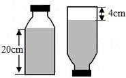

# Mathematics (Grade 6)

**ID**: 2ddfd001
**难度**: medium_hard
**题型**: fill_in_the_blank

## 题目
有一种饮料瓶如图所示，容积是0.6升，现在它里面装有一些饮料，正放时饮料高度为20厘米，倒放时空余部分的高度为4厘米．瓶内现有饮料$\underline{\hspace{5em}}$毫升．

## 解答

**答案**: 500

1. Step1:根据题意可知饮料瓶圆柱体以上部分的容积相当于圆柱部分4厘米高的容积，圆柱体部分高20厘米
2. Step2:计算把饮料瓶容积平均分的份数，即(4 + 20)÷4 = 6份
3. Step3:明确饮料占的份数为5份
4. Step4:将饮料瓶容积0.6升换算为600毫升
5. Step5:计算每份的容积为600÷6 = 100毫升
6. Step6:计算饮料的容积为100×5 = 500毫升

## 知识点

**知识点**:
  - 关于圆柱的应用题．

---
