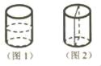

# Mathematics (Grade 6)

**ID**: 36476bfe
**难度**: medium_hard
**题型**: fill_in_the_blank

## 题目
把一个圆柱体木料横切成两个圆柱（图1），表面积增加了25.12cm2，纵切成两个半圆柱（图2），则表面积增加了48cm$^{2}$，原来这个圆柱的体积是_____cm$^{3}$。

## 解答

**答案**: 75.36

1. Step1:计算圆柱的底面积，25.12÷2 = 12.56平方厘米
2. Step2:计算底面半径的平方，12.56÷3.14 = 4
3. Step3:确定圆柱的底面半径，因为2的平方是4，所以半径是2厘米
4. Step4:计算圆柱的高，48÷2÷(2×2)=24÷4 = 6厘米
5. Step5:计算圆柱的体积，3.14×2²×6=3.14×4×6 = 75.36立方厘米

## 知识点

**知识点**:
  - 小学数学;图形与几何;立体图形;圆柱和圆锥;圆柱的体积

---
