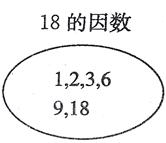

# Mathematics (Grade 6)

**ID**: 3d58b947
**难度**: medium_hard
**题型**: fill_in_the_blank

## 题目
把18的因数按从小到大的顺序有规律地写在椭圆里，用逗号隔开，写完后不用加句号。
具体表示方法： 
  
根据找18的因数的方法找出30和36的因数。
30的因数有：__________；
36的因数有：__________。

## 解答

**答案**: 1，2，3，5，6，10，15，30, 1，2，3，4，6，9，12，18，36

1. Step1:根据找因数的方法，从最小的自然数1找起，一对对找30的因数，30＝1×30＝2×15＝3×10＝5×6，得到30的因数为1，2，3，5，6，10，15，30
2. Step2:同样根据找因数的方法，从1找起，一对对找36的因数，36＝1×36＝2×18＝3×12＝4×9＝6×6，得到36的因数为1，2，3，4，6，9，12，18，36

## 知识点

**知识点**:
  - 小学数学;数与代数;数的认识;整数的认识;因数与倍数;因数和倍数的求法

---
