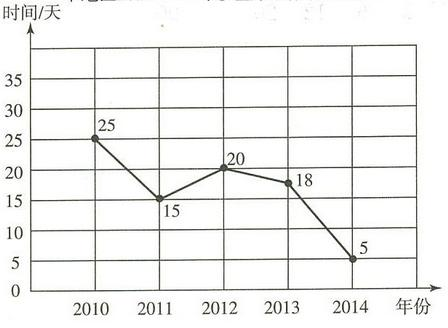

# Mathematics (Grade 6)

**ID**: 3e1bfe6b
**难度**: medium_hard
**题型**: fill_in_the_blank

## 题目
甲地区2010－2014年沙尘暴天数统计图

   ①（   ）年的沙尘暴总天数最多， 2012 年沙尘暴的天数是（   ）天．

## 解答

**答案**: 2010, 2014

1. Step1:观察统计图，明确横轴表示年份，纵轴表示时间（天数）
2. Step2:查看各年份对应的纵坐标数值，2010年对应的数值是25天，2011年对应的数值是15天，2012年对应的数值是20天，2013年对应的数值是18天，2014年对应的数值是5天
3. Step3:比较各年份天数大小，25＞20＞18＞15＞5，所以2010年的沙尘暴总天数最多
4. Step4:从统计图中可知2012年沙尘暴的天数是20天

## 知识点

**知识点**:
  - 折线统计图
--

---
