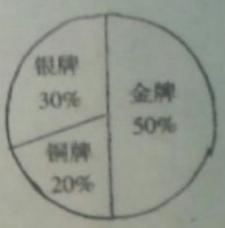

# Mathematics (Grade 6)

**ID**: 402899c6
**难度**: medium_hard
**题型**: fill_in_the_blank

## 题目
我国体育健儿在某届运动会上又一次创出惊人成绩，共获得奖牌320枚．金、银、铜牌数各占奖牌总数的百分比情况如下图．

 金牌50% 银牌占30% 铜牌占20%
 请求出各种奖牌的数量．
 金牌有（  ）枚，银牌有（  ）枚，铜牌有（  ）枚．

## 解答

**答案**: 160, 96, 64

1. Step1:根据已知，奖牌总数为320枚，金牌占奖牌总数的50%，所以计算金牌数量为320×50%=160枚
2. Step2:已知银牌占奖牌总数的30%，计算银牌数量为320×30%=96枚
3. Step3:已知铜牌占奖牌总数的20%，计算铜牌数量为320×20%=64枚

## 知识点

**知识点**:
  - --

---
