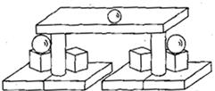

# Mathematics (Grade 6)

**ID**: 44af6218
**难度**: medium_hard
**题型**: fill_in_the_blank

## 题目
数一数，填一填。

$\begin{array}{|c|c|c|c|}
\hline
长方体
 & 正方体
 & 圆柱
 & 球
 \\\hline
（\underline{\hspace{5em}}）个
 & （\underline{\hspace{5em}}）个
 & （\underline{\hspace{5em}}）个
 & （\underline{\hspace{5em}}）个
 \\\hline
\end{array}$

## 解答

**答案**: 5, 4, 2, 3

1. Step1:观察图片，寻找长方体，经计数可得长方体有5个
2. Step2:观察图片，寻找正方体，经计数可得正方体有4个
3. Step3:观察图片，寻找圆柱，经计数可得圆柱有2个
4. Step4:观察图片，寻找球，经计数可得球有3个

## 知识点

**知识点**:
  - 小学数学;图形与几何;立体图形;立体图形的认识及分类

---
