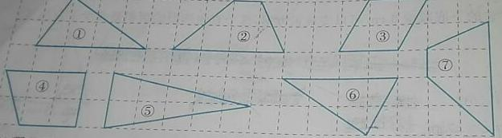

# Mathematics (Grade 6)

**ID**: 4a07753f
**难度**: medium_hard
**题型**: fill_in_the_blank

## 题目
下图中每个小方格的边长为1cm。

 (1)哪些图形的面积是相等的？
 $\_\_\_\_\_\_$
 (2)图(    )和图(    )，图(    )和图(    )都能拼成平行四边形。

## 解答

**答案**: ①⑤⑥③的面积是相等的、②④⑦是相等的, ①, ⑥, ②, ④

1. Step1:根据解析2，由于每个小方格边长为1cm，分别计算图①的面积。假设图①为三角形，底为4cm，高为2cm，根据三角形面积公式S = 1/2×底×高，可得其面积为1/2×4×2 = 4cm²
2. Step2:计算图②的面积。假设图②为梯形，上底为2cm，下底为4cm，高为2cm，根据梯形面积公式S = 1/2×(上底 + 下底)×高，可得其面积为1/2×(2 + 4)×2 = 6cm²
3. Step3:计算图③的面积。假设图③为三角形，底为4cm，高为2cm，根据三角形面积公式可得其面积为1/2×4×2 = 4cm²
4. Step4:计算图④的面积。假设图④为梯形，上底为2cm，下底为4cm，高为2cm，根据梯形面积公式可得其面积为1/2×(2 + 4)×2 = 6cm²
5. Step5:计算图⑤的面积。假设图⑤为三角形，底为4cm，高为2cm，根据三角形面积公式可得其面积为1/2×4×2 = 4cm²
6. Step6:计算图⑥的面积。假设图⑥为三角形，底为4cm，高为2cm，根据三角形面积公式可得其面积为1/2×4×2 = 4cm²
7. Step7:计算图⑦的面积。假设图⑦为梯形，上底为2cm，下底为4cm，高为2cm，根据梯形面积公式可得其面积为1/2×(2 + 4)×2 = 6cm²
8. Step8:比较各图形面积，得出①⑤⑥③的面积是相等的、②④⑦是相等的
9. Step9:根据解析2，观察各图形边长，发现图①和图⑥有对应相等的边，所以图①和图⑥能拼成平行四边形
10. Step10:观察各图形边长，发现图②和图④有对应相等的边，所以图②和图④能拼成平行四边形

## 知识点

**知识点**:
  - --

---
