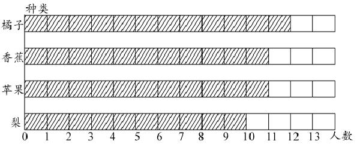

# Mathematics (Grade 6)

**ID**: 4c36d502
**难度**: medium_hard
**题型**: fill_in_the_blank

## 题目
调查记录填空。
二（6）班学生最喜欢吃的水果调查图

（1）此图反映的是（______）年级（______）班学生（______）情况的调查图。
（2）从图中可知，喜欢吃（______）的人最多，是（______）人；喜欢吃（______）的最少。是（______）人；喜欢吃（______）和（______）的人同样多，是（______）人。
（3）这个班共有（______）人。

## 解答

**答案**: 二, 六, 喜欢吃水果, 橘子, 12, 梨, 10, 香蕉, 苹果, 11, 44

1. Step1:观察题目可知，第一个问题是询问调查图反映的年级、班级和调查内容，根据题目开头可知是二（6）班学生最喜欢吃的水果调查图，所以第一个问题答案依次为二、六、喜欢吃水果
2. Step2:观察调查图，数出喜欢每种水果的人数，橘子对应的人数为12人，香蕉对应的人数为11人，苹果对应的人数为11人，梨对应的人数为10人，比较可得喜欢吃橘子的人最多，是12人；喜欢吃梨的最少，是10人；喜欢吃香蕉和苹果的人同样多，是11人
3. Step3:计算这个班的总人数，将喜欢吃各种水果的人数相加，即12 + 11 + 11 + 10 = 44人

## 知识点

**知识点**:
  - 小学数学;统计和概率;统计;数据的搜集与整理

---
