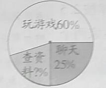

# Mathematics (Grade 6)

**ID**: 4c53f3bf
**难度**: medium_hard
**题型**: fill_in_the_blank

## 题目
下面是对留六年级同学上网情况调查后制成的扇形统计图(玩游戏的占60%，聊天的占25%，查资料的占多少？)

 （1）图中表示玩游戏的占上网总人数的（   ）%
 （2）如果上网的有80人，查资料的有（   ）%，有（   ）人

## 解答

**答案**: 60%, 15%, 12

1. Step1:观察扇形统计图可知玩游戏的占上网总人数的60%
2. Step2:计算查资料的占比，用1减去玩游戏的60%和聊天的25%，即1 - 60% - 25% = 15%
3. Step3:已知上网有80人，计算查资料的人数，用上网总人数80乘以查资料的占比15%，即80×15% = 12人

## 知识点

**知识点**:
  - --

---
