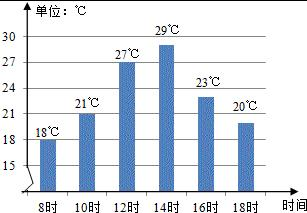

# Mathematics (Grade 6)

**ID**: 4cebca13
**难度**: medium_hard
**题型**: fill_in_the_blank

## 题目
我校气象小组测量出某一天气温如下：
8时  18℃； 10时  21℃； 12时  27℃； 14时 29℃；16时 23℃；18时 20℃

①这一天，______时的气温最高，______时的温度最低．
②这一天的平均气温是多少摄氏度？

## 解答

**答案**: 14, 8, 23

1. Step1:观察所给的不同时刻气温数据，8时为18℃，10时为21℃，12时为27℃，14时为29℃，16时为23℃，18时为20℃，比较大小可得14时的气温最高，8时的气温最低
2. Step2:计算平均气温，先将6个时刻的气温相加，即18 + 21 + 27 + 29 + 23 + 20 = 138
3. Step3:用总和除以测量次数6，138÷6 = 23，得到平均气温为23℃

## 知识点

**知识点**:
  - 统计图表的填补;平均数的含义及求平均数的方法;从统计图表中获取信息．

---
