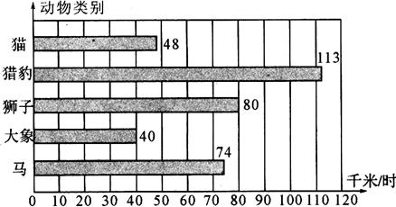

# Mathematics (Grade 6)

**ID**: 4d7d0da7
**难度**: medium_hard
**题型**: fill_in_the_blank

## 题目
下图是五种动物的最高时速统计图

$\underline{\hspace{5em}}$跑得最快，每小时跑$\underline{\hspace{5em}}$千米；$\underline{\hspace{5em}}$谁跑得最慢，每小时跑$\underline{\hspace{5em}}$千米．

## 解答

**答案**: 猎豹, 113, 大象, 40

1. Step1:观察统计图中五种动物对应的时速数据
2. Step2:比较五种动物时速大小，找出最大时速对应的动物为猎豹，其时速为113千米
3. Step3:再次比较五种动物时速大小，找出最小时速对应的动物为大象，其时速为40千米

## 知识点

**知识点**:
  - 以一当五（或以上）的条形统计图；从统计图表中获取信息．

---
