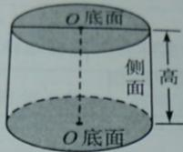

# Mathematics (Grade 6)

**ID**: 4f8dfe30
**难度**: medium_hard
**题型**: fill_in_the_blank

## 题目

 底面  底面  侧面  高
 两底面是(    )的(    )．侧面是一个
 (    )面，展开后是(    )形，长相当于圆柱的(    )，宽相当于圆柱的(    )．

## 解答

**答案**: 面积相等, 圆, 曲, 长方, 底面周长, 高

1. Step1:明确第一个空，根据圆柱的特征，两底面的面积关系是面积相等
2. Step2:确定第二个空，圆柱的底面形状是圆
3. Step3:得出第三个空，圆柱侧面的性质是曲面
4. Step4:判断第四个空，圆柱侧面展开后的形状是长方形
5. Step5:明确第五个空，侧面展开后长方形的长对应圆柱的底面周长
6. Step6:确定第六个空，侧面展开后长方形的宽对应圆柱的高

## 知识点

**知识点**:
  - 

---
