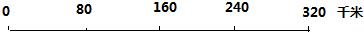

# Mathematics (Grade 6)

**ID**: 504ed25a
**难度**: medium_hard
**题型**: fill_in_the_blank

## 题目
在比例尺是
的图上，量得A、B两点间的距离是3.2厘米，A、B两地实际距离是$\underline{\hspace{5em}}$千米．

## 解答

**答案**: 256

1. Step1:明确线段比例尺的含义，即图上1厘米表示实际距离80千米
2. Step2:已知量得A、B两点间的图上距离是3.2厘米
3. Step3:根据上述信息，用图上距离3.2厘米乘以80千米/厘米，即3.2×80 = 256千米，得到A、B两地的实际距离

## 知识点

**知识点**:
  - 比例尺应用题．

---
