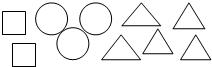

# Mathematics (Grade 6)

**ID**: 5286ba94
**难度**: medium_hard
**题型**: fill_in_the_blank

## 题目
图中，正方形的个数占图形总个数的$\frac{()}{()}，圆的个数占图形总个数的\frac{()}{()}$．

## 解答

**答案**: 1/5, 3/10

1. Step1:数出图中正方形的个数为2个
2. Step2:数出图中圆的个数为3个
3. Step3:数出图中图形的总个数为10个
4. Step4:根据分数的意义，计算正方形个数占图形总个数的比例为2÷10 = 2/10 = 1/5
5. Step5:根据分数的意义，计算圆的个数占图形总个数的比例为3÷10 = 3/10

## 知识点

**知识点**:
  - 分数的意义、读写及分类．

---
