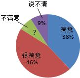

# Mathematics (Grade 6)

**ID**: 531ca22f
**难度**: medium_hard
**题型**: fill_in_the_blank

## 题目
某商场为了提高本商场的服务质量，随机调查了本商场的100名顾客，调查的结果如图所示．根据图中给出的信息，这100名顾客中对该商场的服务质量表示不满意的有$\underline{\hspace{5em}}$人．

## 解答

**答案**: 7

1. Step1:把抽查的100名顾客看作单位'1'
2. Step2:计算不满意的人占的百分率，即1 - 46% - 38% - 9% = 7%
3. Step3:根据“求一个数的百分之几是多少，用乘法计算”，计算不满意的人数为100×7% = 7人

## 知识点

**知识点**:
  - 扇形统计图；百分数的实际应用．

---
