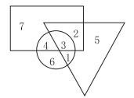

# Mathematics (Grade 6)

**ID**: 537b354a
**难度**: medium_hard
**题型**: fill_in_the_blank

## 题目
仔细观察下图，再填空。

在长方形内的数有（），在圆形内的数有（），在三角形内的数有（）。

## 解答

**答案**: 2，3，4，7, 1，3，4，6, 1、2、3、5

1. Step1:观察图形，找出完全在长方形区域内的数字，得到2，3，4，7
2. Step2:观察图形，找出完全在圆形区域内的数字，得到1，3，4，6
3. Step3:观察图形，找出完全在三角形区域内的数字，得到1，2，3，5

## 知识点

**知识点**:
  - 圆的认识;三角形的认识;长、正方形的认识

---
