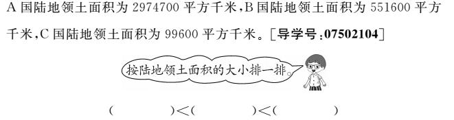

# Mathematics (Grade 6)

**ID**: 5451538c
**难度**: medium_hard
**题型**: fill_in_the_blank

## 题目

A国陆地领土的面积为2974700平方千米，B陆地领土面积为551600平方千米，C国陆地领土面积为99600平方千米。
按陆地领土面积的大小排一排。
（）＜（）＜（）

## 解答

**答案**: C, B, A

1. Step1:明确A国陆地领土面积为2974700平方千米，是七位数
2. Step2:明确B国陆地领土面积为551600平方千米，是六位数
3. Step3:明确C国陆地领土面积为99600平方千米，是五位数
4. Step4:根据整数大小比较方法，数位多的数大，可得99600＜551600＜2974700
5. Step5:按照面积大小对应的国家顺序，得出C＜B＜A
6. Step6:提取出对应的国家字母，得到['C', 'B', 'A']

## 知识点

**知识点**:
  - 整数大小的比较

---
