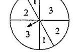

# Mathematics (Grade 6)

**ID**: 551af425
**难度**: medium_hard
**题型**: fill_in_the_blank

## 题目
某商场搞促销，凡是购物满500元，即是一次机会转动转盘（如图）。转动转盘，指针指向几，就获得几等奖。获得（    ）等奖的可能性最大，获得（    ）等奖的可能性最小.

## 解答

**答案**: 3, 1

1. Step1:观察转盘可知，转盘被平均分成了6份
2. Step2:其中标有1的区域有1份
3. Step3:标有2的区域有2份
4. Step4:标有3的区域有3份
5. Step5:根据可能性大小的比较方法，总情况数目相同（都是转动一次转盘这一种情况），3等奖对应的区域份数最多，所以获得3等奖的可能性最大
6. Step6:1等奖对应的区域份数最少，所以获得1等奖的可能性最小

## 知识点

**知识点**:
  - 全真模拟训练密卷-重点学校卷（三）
-

---
