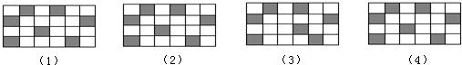

# Mathematics (Grade 6)

**ID**: 55d755a5
**难度**: medium_hard
**题型**: fill_in_the_blank

## 题目
仔细观察，下面的第$\underline{\hspace{5em}}$幅图与其他的图不一样．

## 解答

**答案**: 3

1. Step1:观察图（1），确定其涂色部分的位置
2. Step2:观察图（2），确定其涂色部分的位置
3. Step3:观察图（3），确定其涂色部分的位置
4. Step4:观察图（4），确定其涂色部分的位置
5. Step5:对比图（1）、（2）、（3）、（4）中涂色部分的位置，发现图（1）、（2）、（4）涂色部分位置一样，图（3）中涂色位置与它们不同
6. Step6:得出第（3）幅图与其他的图不一样，答案为3

## 知识点

**知识点**:
  - 物体的比较、排列和分类．

---
