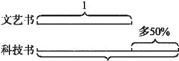

# Mathematics (Grade 6)

**ID**: 578ae4c3
**难度**: medium_hard
**题型**: fill_in_the_blank

## 题目
看图填空．

图中把______当作“1”，______比______多的部分占______的50%，如果文艺书有800册，则科技书有______册．

## 解答

**答案**: 文艺书数量, 科技书, 文艺书, 文艺书, 1200

1. Step1:观察图可知，把文艺书当作“1”
2. Step2:从图中能看出科技书比文艺书多的部分，多的部分占文艺书的50%
3. Step3:已知文艺书有800册，因为科技书比文艺书多50%，所以科技书是文艺书的(1 + 50%)
4. Step4:根据上述关系，计算科技书的册数为800×(1 + 50%) = 1200册

## 知识点

**知识点**:
  - 百分数的实际应用．

---
