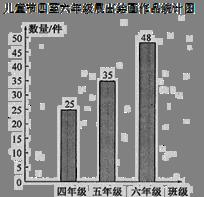

# Mathematics (Grade 6)

**ID**: 5841b02b
**难度**: medium_hard
**题型**: fill_in_the_blank

## 题目
读统计图，填空、解决问题。

1、填空：这个统计图中每小格表示（  ）件，六年级的绘画作品比四年级多（  ）件。
2、平均每个年级展出绘画作品多少件？

## 解答

**答案**: 5, 13, 36

1. Step1:观察统计图，可知纵轴上相邻两个刻度的差值为5，所以这个统计图中每小格表示5件
2. Step2:已知六年级绘画作品有48件，四年级绘画作品有25件，计算六年级比四年级多的件数，即48 - 25 = 23件
3. Step3:计算三个年级绘画作品的总数，25 + 35 + 48 = 108件
4. Step4:求平均每个年级展出绘画作品的件数，用总数除以年级数3，即108÷3 = 36件

## 知识点

**知识点**:
  - 小学数学;统计和概率;统计;统计图

---
