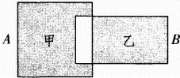

# Mathematics (Grade 6)

**ID**: 5b69d286
**难度**: medium_hard
**题型**: fill_in_the_blank

## 题目
正方形A的边长为5厘米，长方形B的长边为6厘米，短边为3厘米，现在把它们如图那样重叠放置．阴影部分甲比阴影部分乙大多少$厘米^{2}？$

## 解答

**答案**: 7

1. Step1:计算正方形A的面积，根据正方形面积公式S=a²（a为边长），可得5×5=25平方厘米
2. Step2:计算长方形B的面积，根据长方形面积公式S=长×宽，可得6×3=18平方厘米
3. Step3:求正方形A与长方形B的面积差，25 - 18 = 7平方厘米，此面积差即为阴影部分甲比阴影部分乙大的面积

## 知识点

**知识点**:
  - 重叠问题．

---
