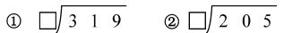

# Mathematics (Grade 6)

**ID**: 5d31d9ab
**难度**: medium_hard
**题型**: fill_in_the_blank

## 题目
在□里填上合适的数，使商的中间有一个0。

## 解答

**答案**: 3, 1, 2

1. Step1:分析①，对于319÷□，要使商中间有0，根据解题方法，被除数百位3除以除数余数为0且十位1比除数小，3能被3整除，所以□填3
2. Step2:分析②，对于205÷□，要使商中间有0，根据解题方法，被除数百位2除以除数余数为0，2能被1整除，也能被2整除，所以□可填1或2
3. Step3:综上，得到答案为3、1、2

## 知识点

**知识点**:
  - 一位数乘两、三位数

---
