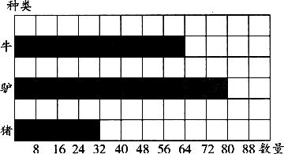

# Mathematics (Grade 6)

**ID**: 5de139b7
**难度**: medium_hard
**题型**: fill_in_the_blank

## 题目
看图填空．
某饲养场养牛、驴、猪三种牲畜的头数如下图．

【小题1】驴比牛多$\frac{1}{4}$，驴比牛多多少头？
求驴比牛多多少头，就是求（______）的数量的（______），列式是（______）×（______）．
【小题2】猪是牛的$\frac{1}{2}$，猪有多少头？
求猪有多少头，就是求（______）的数量的（______），列式是（______）×（______）．

## 解答

**答案**: 牛, 1/4, 64, 1/4, 牛, 1/2, 64, 1/2

1. Step1:分析小题1，求驴比牛多多少头，已知驴比牛多$rac{1}{4}$，这里是把牛的数量看作单位‘1’，所以就是求牛的数量的$rac{1}{4}$；从图中可知牛的数量是64头，所以列式是64×$rac{1}{4}$
2. Step2:分析小题2，求猪有多少头，已知猪是牛的$rac{1}{2}$，把牛的数量看作单位‘1’，就是求牛的数量的$rac{1}{2}$；从图中可知牛的数量是64头，所以列式是64×$rac{1}{2}$

## 知识点

**知识点**:
  - 小学数学;统计和概率;统计;统计图;复式条形统计图

---
