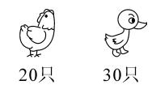

# Mathematics (Grade 6)

**ID**: 5e03cf66
**难度**: medium_hard
**题型**: fill_in_the_blank

## 题目
想一想，算一算。（xiǎng yī xiǎng，suàn yī suàn）

鸡和鸭一共有多少只？
□○□=□（只）
鸭比鸡多多少只？
□○□=□（只）

## 解答

**答案**: 20+30=50, 30-20=10

1. Step1:明确题目要求，需分别求出鸡和鸭一共的只数以及鸭比鸡多的只数
2. Step2:对于鸡和鸭一共的只数，根据解题方法提示，求20与30的和，用加法计算，得出20+30=50
3. Step3:对于鸭比鸡多的只数，根据解题方法提示，求30比20多多少，用减法计算，得出30-20=10

## 知识点

**知识点**:
  - 整数的加法和减法

---
