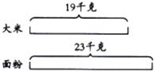

# Mathematics (Grade 6)

**ID**: 5e6a35c5
**难度**: medium_hard
**题型**: fill_in_the_blank

## 题目
看图填写

（1）大米的千克数是面粉的$\frac{()}{()}$；
（2）面粉的千克数是大米的$\frac{()}{()}$．

## 解答

**答案**: 19, 23, 1, 4, 19

1. Step1:求大米的千克数是面粉的几分之几，根据解析2，用大米的重量19除以面粉的重量23，即19÷23=$\frac{19}{23}$，所以第一个空填19，第二个空填23
2. Step2:求面粉的千克数是大米的几分之几，根据解析2，用面粉的重量23除以大米的重量19，23÷19=1$\frac{4}{19}$，所以第三个空填1，第四个空填4，第五个空填19

## 知识点

**知识点**:
  - 分数除法．

---
