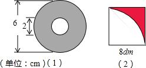

# Mathematics (Grade 6)

**ID**: 600e1b56
**难度**: medium_hard
**题型**: fill_in_the_blank

## 题目
求图中涂色部分的面积．
（1）$\underline{\hspace{5em}}$
（2）$\underline{\hspace{5em}}$．

## 解答

**答案**: 25.12cm^2, 13.76dm^2

1. Step1:计算图（1）中大半圆半径，6÷2 = 3（cm）
2. Step2:计算图（1）中小半圆半径，2÷2 = 1（cm）
3. Step3:根据圆环面积公式计算图（1）阴影部分面积，3.14×（3×3 - 1×1）= 3.14×8 = 25.12（cm²）
4. Step4:计算图（2）中正方形面积，8×8 = 64（dm²）
5. Step5:计算图（2）中四分之一圆的面积，3.14×8×8÷4 = 50.24（dm²）
6. Step6:用正方形面积减去四分之一圆的面积得到图（2）阴影部分面积，64 - 50.24 = 13.76（dm²）

## 知识点

**知识点**:
  - 组合图形的面积．

---
