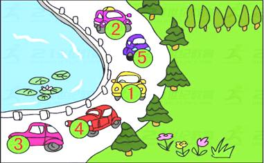

# Mathematics (Grade 6)

**ID**: 68e396db
**难度**: medium_hard
**题型**: fill_in_the_blank

## 题目
数一数，填一填

（1）1号的前面是________，5号的后面是________。   
（2）4号在________号的前面，在________号后面。   
（3）目前开的最快的是________号，最慢的是________号。   
（4）5号在1号的________面，3号在4号的________面。

## 解答

**答案**: 4号, 2号, 1, 3, 3, 2, 后, 前

1. Step1:观察图片，确定车辆行驶方向为从右向左。
2. Step2:看1号车，其前面（行驶方向的前方）是4号车，所以（1）中1号的前面是4号。
3. Step3:看5号车，其后面（行驶方向的后方）是2号车，所以（1）中5号的后面是2号。
4. Step4:看4号车，它在1号车的前面，在3号车的后面，所以（2）中4号在1号的前面，在3号后面。
5. Step5:根据行驶顺序，最前面的3号车开得最快，最后面的2号车开得最慢，所以（3）中目前开得最快的是3号，最慢的是2号。
6. Step6:对比5号车和1号车的位置，5号车在1号车的后面，所以（4）中5号在1号的后面。
7. Step7:对比3号车和4号车的位置，3号车在4号车的前面，所以（4）中3号在4号的前面。

## 知识点

**知识点**:
  - 小学数学;图形与几何;位置与方向;位置

---
