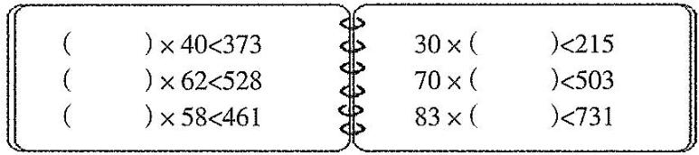

# Mathematics (Grade 6)

**ID**: 690e5267
**难度**: medium_hard
**题型**: fill_in_the_blank

## 题目

 (    )×40<373
 (    )×62<528
 (    )×58<461
 30×(    )<215
 70×(    )<503
 83×(    )<731

## 解答

**答案**: 9, 8, 9, 7, 7, 9

1. Step1:对于( )×40<373，用试商的取整法，把40看作整十数，想40乘几接近373且小于373，360÷40 = 9，所以括号里填9
2. Step2:对于( )×62<528，把62用四舍五入看作60，想60乘几接近528且小于528，480÷60 = 8，所以括号里填8
3. Step3:对于( )×58<461，把58看作60，想60乘几接近461且小于461，450÷50 = 9（这里可类比取整试商思路），所以括号里填9
4. Step4:对于30×( )<215，想30乘几接近215且小于215，210÷30 = 7，所以括号里填7
5. Step5:对于70×( )<503，想70乘几接近503且小于503，490÷70 = 7，所以括号里填7
6. Step6:对于83×( )<731，把83看作80，想80乘几接近731且小于731，720÷80 = 9，所以括号里填9

## 知识点

**知识点**:
  - 除数是两位数的除法-笔算除法（2）
-

---
