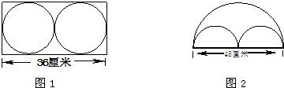

# Mathematics (Grade 6)

**ID**: 6d2ddc98
**难度**: medium_hard
**题型**: fill_in_the_blank

## 题目

图1中圆的直径是______厘米，半径是______厘米．
图2中大半圆的半径是______厘米，小半圆的半径是______厘米．

## 解答

**答案**: 18, 9, 24, 12

1. Step1:根据图1中两个圆的直径总和是36厘米，计算一个圆的直径，即36÷2 = 18厘米
2. Step2:由图1中圆的直径为18厘米，计算其半径，即18÷2 = 9厘米
3. Step3:根据图2中大圆的直径是48厘米，计算大半圆的半径，即48÷2 = 24厘米
4. Step4:由图2中大半圆的半径为24厘米，此半径也是小半圆的直径，计算小半圆的半径，即24÷2 = 12厘米

## 知识点

**知识点**:
  - 圆的认识与圆周率．

---
