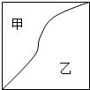

# Mathematics (Grade 6)

**ID**: 6ee1d737
**难度**: medium_hard
**题型**: fill_in_the_blank

## 题目
如图，把一个长方形分成甲、乙两部分，乙的周长大于甲的周长． $\underline{\hspace{5em}}$ （判断对错）

## 解答

**答案**: ×

1. Step1:明确周长的定义为围成图形的所有线段的长度和
2. Step2:观察图形可知，甲的周长由长方形的两条边和中间的曲线段组成
3. Step3:乙的周长同样由长方形的两条边和中间的曲线段组成
4. Step4:对比发现甲和乙所包含的长方形的边是一样的，中间曲线段也是相同的
5. Step5:得出甲和乙的周长相等，所以原说法错误

## 知识点

**知识点**:
  - 长度比较

---
