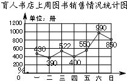

# Mathematics (Grade 6)

**ID**: 72b551cc
**难度**: medium_hard
**题型**: fill_in_the_blank

## 题目
根据图中信息回答问题：
①售出图书最多的一天比最少的一天多(    )册．
②星期五售出的图书册数是星期四的(    )%．

## 解答

**答案**: 600, 137.5

1. Step1:从折线统计图中找出售出图书最多的一天是周六，册数为990册
2. Step2:从折线统计图中找出售出图书最少的一天是周二，册数为390册
3. Step3:计算售出图书最多的一天比最少的一天多的册数，990 - 390 = 600册
4. Step4:从折线统计图中得知周五售出图书册数为550册
5. Step5:从折线统计图中得知周四售出图书册数为400册
6. Step6:计算星期五售出的图书册数是星期四的百分比，550÷400 = 1.375，转化为百分数为137.5%

## 知识点

**知识点**:
  - 单式折线统计图．

---
