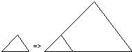

# Mathematics (Grade 6)

**ID**: 78777ff0
**难度**: medium_hard
**题型**: fill_in_the_blank

## 题目
将一个三角形的三条边同时扩大相同的倍数，如图，得到的新三角形的面积变为原三角形面积的9倍，则新三角形的周长是原三角形的周长的(    )倍．

## 解答

**答案**: 3

1. Step1:根据题意可知原三角形与新三角形相似
2. Step2:因为新三角形面积变为原三角形面积的9倍，由相似三角形面积比等于相似比的平方，可得相似比为1:3
3. Step3:依据相似三角形周长比等于相似比，得出原三角形周长与新三角形周长比为1:3
4. Step4:从而得出新三角形的周长是原三角形周长的3倍

## 知识点

**知识点**:
  - 相似三角形的性质（份数、比例）．

---
