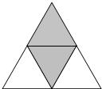

# Mathematics (Grade 6)

**ID**: 793cd458
**难度**: medium_hard
**题型**: fill_in_the_blank

## 题目
如图的大三角形表示428，图中的涂色部分表示 $\underline{\hspace{5em}}$ ．

## 解答

**答案**: 214

1. Step1:观察图形可知大三角形被平均分成4份，阴影部分占2份
2. Step2:由此可得阴影部分面积是大三角形面积的2÷4 = $\frac{1}{2}$
3. Step3:已知大三角形表示428，所以阴影部分表示428×$\frac{1}{2}$
4. Step4:计算428×$\frac{1}{2}$ = 214

## 知识点

**知识点**:
  - 分数乘法

---
