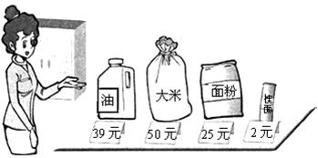

# Mathematics (Grade 6)

**ID**: 7cc6b1e9
**难度**: medium_hard
**题型**: fill_in_the_blank

## 题目

（1）买一袋大米和一桶油共花多少钱？ 
________○________=________(元)
（2）买一袋面粉比买一桶油少花多少钱？ 
________○________=________(元)
（3）付5元钱买一包挂面，应找回多少钱？ 
________○________=________(元)

## 解答

**答案**: 50, +, 39, 89, 39, -, 25, 14, 5, -, 2, 3

1. Step1:计算买一袋大米和一桶油共花的钱数，根据题目可知大米50元，油39元，所以是50 + 39 = 89元
2. Step2:计算买一袋面粉比买一桶油少花的钱数，已知油39元，面粉25元，即39 - 25 = 14元
3. Step3:计算付5元钱买一包挂面应找回的钱数，挂面2元，所以是5 - 2 = 3元

## 知识点

**知识点**:
  - 小学数学;数与代数;应用题;常见的数学问题;图文问题

---
