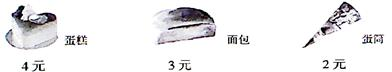

# Mathematics (Grade 6)

**ID**: 7da63f25
**难度**: medium_hard
**题型**: fill_in_the_blank

## 题目
                                                     
（1）张明买了5个蛋糕，李华买了8个蛋筒，谁用的钱多一些？
口答：（   ）用的钱多一些。
（2）买8个面包要多少元？如果用这些钱去买蛋糕，可以买几个？
口答：买8个面包要（   ）元。用这些钱去买蛋糕，可以买（  ）个。

## 解答

**答案**: 张明, 24, 6

1. Step1:计算张明买5个蛋糕的花费，根据蛋糕单价4元，可得4×5 = 20元
2. Step2:计算李华买8个蛋筒的花费，根据蛋筒单价2元，可得2×8 = 16元
3. Step3:比较张明和李华的花费，20＞16，所以张明用的钱多
4. Step4:计算买8个面包的花费，根据面包单价3元，可得3×8 = 24元
5. Step5:用买8个面包的24元去买蛋糕，根据蛋糕单价4元，可得24÷4 = 6个

## 知识点

**知识点**:
  - 小学数学;数与代数;应用题;简单应用题;整数简单应用题

---
