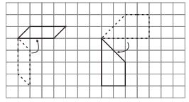

# Mathematics (Grade 6)

**ID**: 7dca32b5
**难度**: medium_hard
**题型**: fill_in_the_blank

## 题目
下面两个图形分别是怎样旋转的？想一想，填一填。

1.平行四边形按（）时针的方向旋转了（）度。
2.梯形按（）时针的方向旋转了（）度。

## 解答

**答案**: 逆, 90, 顺, 90

1. Step1:观察平行四边形，对比原图形与旋转后的图形，确定其旋转方向为逆时针
2. Step2:进一步观察平行四边形，根据图形特征判断其旋转度数为90度
3. Step3:观察梯形，对比原图形与旋转后的图形，确定其旋转方向为顺时针
4. Step4:进一步观察梯形，根据图形特征判断其旋转度数为90度

## 知识点

**知识点**:
  - 旋转

---
