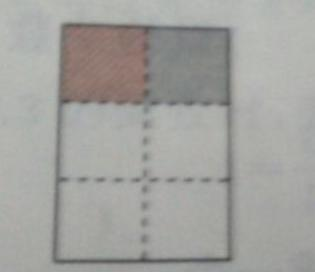

# Mathematics (Grade 6)

**ID**: 7fdb5feb
**难度**: medium_hard
**题型**: fill_in_the_blank

## 题目
看图列式，并计算.

$\frac{1}{3}×\frac{（\,\,）}{（\,\,）}=\frac{(\,\,\,\,)}{(\,\,\,\,)}$

## 解答

**答案**: 4, 2, 2, 3

1. Step1:观察图形，整个大长方形被平均分成3份，取其中1份，表示为$\frac{1}{3}$
2. Step2:再看这$\frac{1}{3}$又被平均分成2份，涂色部分占了其中4份，所以这里的分数是$\frac{4}{2}$
3. Step3:根据分数乘法法则，分子相乘作为分子，分母相乘作为分母，$\frac{1}{3}×\frac{4}{2}=\frac{1×4}{3×2}=\frac{4}{6}$，约分后得到$\frac{2}{3}$
4. Step4:将$\frac{4}{2}$的分子4提取出来
5. Step5:将$\frac{4}{2}$的分母2提取出来
6. Step6:将$\frac{2}{3}$的分子2提取出来
7. Step7:将$\frac{2}{3}$的分母3提取出来

## 知识点

**知识点**:
  - --

---
