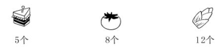

# Mathematics (Grade 6)

**ID**: 8010da43
**难度**: medium_hard
**题型**: fill_in_the_blank

## 题目
看图回答问题。
 
（1）蛋糕和西红柿一共多少个？
□○□=□
（2）笋子比西红柿多多少个？
□○□=□
（3）蛋糕比笋子少多少个？
□○□=□

## 解答

**答案**: 5+8=13, 12-8=4, 12-5=7

1. Step1:根据图形可知蛋糕有5个，西红柿有8个，求蛋糕和西红柿一共多少个，根据加法意义，用5加8，即5 + 8 = 13
2. Step2:根据图形可知笋子有12个，西红柿有8个，求笋子比西红柿多多少个，根据减法意义，用12减8，即12 - 8 = 4
3. Step3:根据图形可知蛋糕有5个，笋子有12个，求蛋糕比笋子少多少个，根据减法意义，用12减5，即12 - 5 = 7

## 知识点

**知识点**:
  - 整数的加法和减法

---
