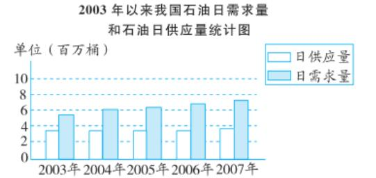

# Mathematics (Grade 6)

**ID**: 825a95f0
**难度**: medium_hard
**题型**: fill_in_the_blank

## 题目
如图是2003年以来我国石油日需求量和石油日供应量的统计图。由图可知，我国石油日需求量和石油日供应量都在增长，但石油日需求量增长更（），可见我国对石油的依赖程度不断（）（增加或减小）。

## 解答

**答案**: 快, 增加

1. Step1:观察统计图，根据图例确定浅色表示日供应量，深色表示日需求量
2. Step2:对比日需求量和日供应量的增长情况，发现日需求量增长幅度更大，所以石油日需求量增长更快
3. Step3:因为日需求量的增长超过日供应量的增长，根据判断规则可知我国对进口石油的依赖程度不断增加，即我国对石油的依赖程度不断增加

## 知识点

**知识点**:
  - 从统计图表中获取信息;复式条形统计图

---
